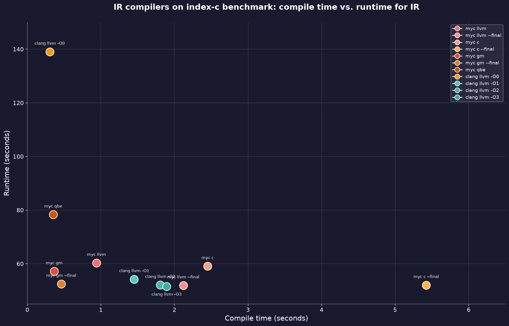

# Set of Benchmarks for [myc](https://github.com/kostya/myc).

Environment:

- **CPU:** Ryzen 3800X
- **RAM:** 78 GB DDR4-3200
- **OS:** Linux arch 7.2.7
- **Docker:** 29.8.1

Prepare environment:
```
docker build -t myc-benchmarks .
```

Show versions:
```
docker run --rm myc-benchmarks sh -c 'for t in clang gcc cproc qbe cppgm myc-llvm myc-qbe myc-c myc-gm; do printf "%s: " "$t"; command -v "$t" >/dev/null 2>&1 && { "$t" --version 2>&1 | head -n1 || "$t" -v 2>&1 | head -n1; } || echo "not found"; done'
```

```
clang: clang version 23.1.5
gcc: gcc (GCC) 16.2.1 20260810
cppgm: cppgm 0.10.0 (host configuration: g++)
myc-llvm: myc 0.12.3-faed679 LLVM 23.1.5 (https://github.com/kostya/myc)
myc-qbe: myc 0.12.3-faed679 QBE fab6d40 (https://github.com/kostya/myc)
myc-c: myc 0.12.3-faed679 C(clang version 23.1.5) (https://github.com/kostya/myc)
myc-gm: myc 0.12.3-faed679 GM v0.10.0 (https://github.com/kostya/myc)
```

# 1. C compilers on index-c: (clang, gcc, mycc, cproc)

Running on [index-c](https://github.com/kostya/index-c) benchmark.

```
docker run --rm -it -w /src -v `pwd`:/src myc-benchmarks
cd 1.index-c
ruby run.rb
```

| Compiler | Backend | Flags | Compile (s) | Run (s) |
|----------|---------|-------|-------------|---------|
| mycc | llvm |  | 1.3718 | 60.3906 |
| mycc | llvm | --final | 2.5505 | 52.0201 |
| mycc | c |  | 2.4711 | 56.3605 |
| mycc | c | --final | 3.1584 | 51.7813 |
| mycc | gm |  | 0.7872 | 58.3142 |
| mycc | gm | --final | 0.8829 | 53.052 |
| mycc | qbe |  | 0.7822 | 78.6111 |
| clang | llvm | -O0 | 0.3464 | 143.7007 |
| clang | llvm | -O1 | 1.6591 | 54.0613 |
| clang | llvm | -O2 | 2.0215 | 51.1898 |
| clang | llvm | -O3 | 2.0873 | 51.5187 |
| gcc | - | -O0 | 0.8073 | 133.0161 |
| gcc | - | -O1 | 1.8845 | 57.435 |
| gcc | - | -O2 | 3.6576 | 52.4008 |
| gcc | - | -O3 | 4.7835 | 50.7824 |
| cproc | qbe |  | 0.204 | 89.0974 |


# 2. Pure IR files on index-c: (myc, clang)

Running on [index-c](https://github.com/kostya/index-c) benchmark. But index.c transformed into index-c.myc and index-c.ll. This benchmark show pure IR compilation capabilities without C frontend overhead.

```
docker run --rm -it -w /src -v `pwd`:/src myc-benchmarks
cd 2.index-c.ir
ruby gen_ir.rb
ruby run.rb
```

| Compiler | Backend | Flags | Compile (s) | Run (s) |
|----------|---------|-------|-------------|---------|
| myc | llvm |  | 0.9525 | 60.3663 |
| myc | llvm | --final | 2.1375 | 52.1098 |
| myc | c |  | 2.0165 | 56.3654 |
| myc | c | --final | 2.7407 | 52.0036 |
| myc | gm |  | 0.3764 | 58.2623 |
| myc | gm | --final | 0.471 | 53.3131 |
| myc | qbe |  | 0.3589 | 78.3446 |
| clang | llvm | -O0 | 0.1991 | 138.8511 |
| clang | llvm | -O1 | 1.4592 | 54.3862 |
| clang | llvm | -O2 | 1.8153 | 52.386 |
| clang | llvm | -O3 | 1.891 | 51.587 |



# 3. Brainfuck compiler: (llvm, qbe, myc, cppgm)

Compile mandelbrot brainfuck program by Erik Bosman using 4 pure backend and myc as 5 proxy backend.

```
docker run --rm -it -w /src -v `pwd`:/src myc-benchmarks
cd 3.brainfuck-compiler/
ruby run.rb
```

| IR | Compiler | IR size, Kb | Compile time | Run time |
|:---------:|:---------:|:---------:|:---------:|:---------:|
| llvm-ll | clang(-O3) | 1529 | 1173ms | 636ms |
| myc | myc-llvm(default) | 486 | 235ms | 685ms |
| myc | myc-llvm(final) | 486 | 1169ms | 622ms |
| qbe-ssa | qbe + clang(as+linker) | 345 | 80ms + 51ms | 813ms |
| myc | myc-qbe(default) | 486 | 511ms | 852ms |
| c | clang(-O3) | 128 | 1237ms | 627ms |
| myc | myc-c(default) | 486 | 1451ms | 635ms |
| myc | myc-c(final) | 486 | 1649ms | 624ms |
| lowir | cppgm(-O3) | 1157 | 148ms | 649ms |
| myc | myc-gm(default) | 486 | 138ms | 682ms |
| myc | myc-gm(final) | 486 | 186ms | 675ms |

# 4. Myc examples: (myc)

```
docker run --rm -it -w /src -v `pwd`:/src myc-benchmarks
cd 4.examples/
ruby run.rb
```

| Benchmark | Backend | Compile | Run |
|:----------|:-------:|--------:|----:|
| mandel.myc | myc-llvm | 241ms | 684ms |
| | myc-qbe | 520ms | 852ms |
| | myc-c | 1470ms | 636ms |
| | myc-gm | 143ms | 681ms |
| | myc-llvm-final | 1189ms | 621ms |
| | myc-qbe-final | 522ms | 853ms |
| | myc-c-final | 1656ms | 626ms |
| | myc-gm-final | 192ms | 674ms |
| bf.myc | myc-llvm | 54ms | 2449ms |
| | myc-qbe | 41ms | 2697ms |
| | myc-c | 78ms | 2584ms |
| | myc-gm | 39ms | 6074ms |
| | myc-llvm-final | 64ms | 2549ms |
| | myc-qbe-final | 42ms | 2691ms |
| | myc-c-final | 83ms | 2781ms |
| | myc-gm-final | 42ms | 1596ms |
| loop.myc | myc-llvm | 48ms | 206ms |
| | myc-qbe | 40ms | 2437ms |
| | myc-c | 62ms | 185ms |
| | myc-gm | 36ms | 327ms |
| | myc-llvm-final | 52ms | 191ms |
| | myc-qbe-final | 39ms | 2437ms |
| | myc-c-final | 65ms | 139ms |
| | myc-gm-final | 37ms | 318ms |
| loop.c | myc-llvm | 85ms | 199ms |
| | myc-qbe | 86ms | 2437ms |
| | myc-c | 107ms | 185ms |
| | myc-gm | 81ms | 321ms |
| | myc-llvm-final | 86ms | 217ms |
| | myc-qbe-final | 84ms | 205ms |
| | myc-c-final | 84ms | 200ms |
| | myc-gm-final | 85ms | 201ms |
| sieve.c | myc-llvm | 99ms | 288ms |
| | myc-qbe | 99ms | 291ms |
| | myc-c | 123ms | 289ms |
| | myc-gm | 94ms | 299ms |
| | myc-llvm-final | 99ms | 290ms |
| | myc-qbe-final | 99ms | 286ms |
| | myc-c-final | 99ms | 287ms |
| | myc-gm-final | 99ms | 289ms |

# 5. Myc-GM vs Clang in index-c. Detailed.

```
docker run --rm -it -w /src -v `pwd`:/src myc-benchmarks
cd 5.myc-gm-vs-clang/
ruby run.rb
```

compile mycc --backend gm --final in 0.884659357
compile clang -O3 in 2.083505013

| # | test | mycc --backend gm --final | clang -O3 | Δ (s) | slowdown (%) | status |
|---|---|---|---|---|---|---|
| 1 | Etc::GameOfLife | 1.407 | 1.085 | +0.322 | +29.7% | OK |
| 2 | Etc::TextRaytracer | 1.265 | 0.977 | +0.288 | +29.5% | OK |
| 3 | Base64::Decode | 1.362 | 1.066 | +0.296 | +27.8% | OK |
| 4 | Compress::HuffDecode | 0.604 | 0.491 | +0.113 | +23.0% | OK |
| 5 | Etc::NeuralNet | 1.223 | 0.997 | +0.226 | +22.7% | OK |
| 6 | Compress::BWTEncode | 1.271 | 1.040 | +0.231 | +22.2% | OK |
| 7 | Template::Parse | 1.138 | 1.022 | +0.116 | +11.4% | OK |
| 8 | Distance::NGram | 1.134 | 1.022 | +0.112 | +11.0% | OK |
| 9 | CLBG::Spectralnorm | 1.118 | 1.016 | +0.102 | +10.0% | OK |
| 10 | Maze::AStar | 1.154 | 1.055 | +0.099 | +9.4% | OK |
| 11 | Distance::Jaro | 1.041 | 0.952 | +0.089 | +9.3% | OK |
| 12 | Brainfuck::Recursion | 1.703 | 1.568 | +0.135 | +8.6% | OK |
| 13 | Sort::Quick | 1.074 | 0.997 | +0.077 | +7.7% | OK |
| 14 | Compress::LZWEncode | 1.291 | 1.200 | +0.091 | +7.6% | OK |
| 15 | Graph::BFS | 1.044 | 0.975 | +0.069 | +7.1% | OK |
| 16 | Maze::BFS | 1.102 | 1.030 | +0.072 | +7.0% | OK |
| 17 | Compress::LZWDecode | 1.124 | 1.056 | +0.068 | +6.4% | OK |
| 18 | Json::ParseMapping | 1.043 | 0.989 | +0.054 | +5.5% | OK |
| 19 | Json::ParseDom | 1.063 | 1.009 | +0.054 | +5.4% | OK |
| 20 | Sort::Merge | 0.816 | 0.781 | +0.035 | +4.5% | OK |
| 21 | Calculator::Ast | 1.043 | 0.999 | +0.044 | +4.4% | OK |
| 22 | Brainfuck::Array | 1.369 | 1.313 | +0.056 | +4.3% | OK |
| 23 | Graph::DFS | 1.016 | 0.976 | +0.040 | +4.1% | OK |
| 24 | Maze::Generator | 1.048 | 1.011 | +0.037 | +3.7% | OK |
| 25 | Sort::Self | 1.105 | 1.083 | +0.022 | +2.0% | OK |
| 26 | Etc::Words | 1.058 | 1.037 | +0.021 | +2.0% | OK |
| 27 | Compress::ArithEncode | 0.969 | 0.950 | +0.019 | +2.0% | OK |
| 28 | CLBG::Mandelbrot | 1.060 | 1.041 | +0.019 | +1.8% | OK |
| 29 | Compress::ArithDecode | 0.972 | 0.955 | +0.017 | +1.8% | OK |
| 30 | Etc::CacheSimulation | 1.007 | 0.996 | +0.011 | +1.1% | OK |
| 31 | Graph::AStar | 0.835 | 0.829 | +0.006 | +0.7% | OK |
| 32 | Matmul::T4 | 1.053 | 1.048 | +0.005 | +0.5% | OK |
| 33 | Matmul::T16 | 0.985 | 0.981 | +0.004 | +0.4% | OK |
| 34 | Matmul::T8 | 0.996 | 0.992 | +0.004 | +0.4% | OK |
| 35 | Matmul::Single | 1.039 | 1.037 | +0.002 | +0.2% | OK |
| 36 | Etc::LogParser | 0.784 | 0.789 | -0.005 | -0.6% | OK |
| 37 | CSV::Parse | 0.970 | 0.981 | -0.011 | -1.1% | OK |
| 38 | Calculator::Interpreter | 1.032 | 1.044 | -0.012 | -1.1% | OK |
| 39 | Template::Regex | 1.106 | 1.119 | -0.013 | -1.2% | OK |
| 40 | Compress::BWTDecode | 1.041 | 1.067 | -0.026 | -2.4% | OK |
| 41 | Json::Generate | 0.958 | 0.991 | -0.033 | -3.3% | OK |
| 42 | Hash::CRC32 | 0.216 | 0.224 | -0.008 | -3.6% | OK |
| 43 | CLBG::Nbody | 1.015 | 1.053 | -0.038 | -3.6% | OK |
| 44 | Base64::Encode | 1.002 | 1.040 | -0.038 | -3.7% | OK |
| 45 | CLBG::Fannkuchredux | 1.045 | 1.090 | -0.045 | -4.1% | OK |
| 46 | Binarytrees::Obj | 1.001 | 1.080 | -0.079 | -7.3% | OK |
| 47 | Compress::HuffEncode | 1.207 | 1.312 | -0.105 | -8.0% | OK |
| 48 | Binarytrees::Arena | 1.631 | 1.885 | -0.254 | -13.5% | OK |
| 49 | Etc::Sieve | 1.098 | 1.493 | -0.395 | -26.5% | OK |
| 50 | Hash::SHA256 | 0.327 | 1.033 | -0.706 | -68.3% | OK |

Summary: myc-gm=52.965s clang=51.777s diff=+1.188s (+2.3%)