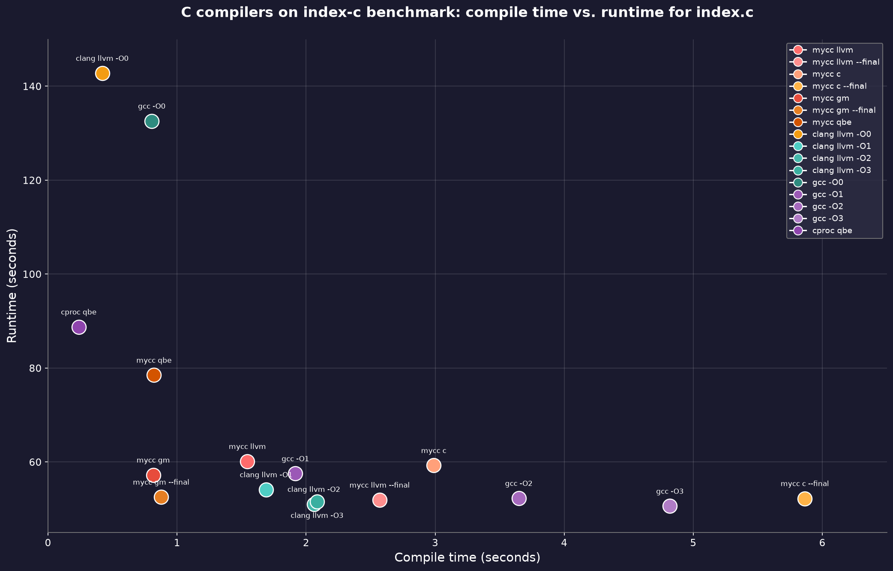

# Set of Benchmarks for [myc](https://github.com/kostya/myc).

Environment:

- **CPU:** Ryzen 3800X
- **RAM:** 78 GB DDR4-3200
- **OS:** Linux arch 7.2.7
- **Docker:** 29.8.1

Prepare environment:
```
docker build -t myc-benchmarks .
```

Show versions:
```
docker run --rm myc-benchmarks sh -c 'for t in clang gcc cproc qbe cppgm myc-llvm myc-qbe myc-c myc-gm; do printf "%s: " "$t"; command -v "$t" >/dev/null 2>&1 && { "$t" --version 2>&1 | head -n1 || "$t" -v 2>&1 | head -n1; } || echo "not found"; done'
```

```
clang: clang version 23.1.5
gcc: gcc (GCC) 16.2.1 20260810
cppgm: cppgm 0.10.3 (host configuration: g++)
myc-llvm: myc 0.13.0-a00f054 LLVM 23.1.5 (https://github.com/kostya/myc)
myc-qbe: myc 0.13.0-a00f054 QBE fab6d40 (https://github.com/kostya/myc)
myc-c: myc 0.13.0-a00f054 C(clang version 23.1.5) (https://github.com/kostya/myc)
myc-gm: myc 0.13.0-a00f054 GM v0.10.3 (https://github.com/kostya/myc)
```

# 1. C compilers on index-c: (clang, gcc, mycc, cproc)

Running on [index-c](https://github.com/kostya/index-c) benchmark.

```
docker run --rm -it -w /src -v `pwd`:/src myc-benchmarks
cd 1.index-c
ruby run.rb
```

| Compiler | Backend | Flags | Compile (s) | Run (s) |
|----------|---------|-------|-------------|---------|
| mycc | llvm |  | 1.2843 | 60.9974 |
| mycc | llvm | --final | 2.4684 | 51.9266 |
| mycc | c |  | 2.3561 | 57.2093 |
| mycc | c | --final | 3.0647 | 52.8705 |
| mycc | gm |  | 0.7047 | 58.2295 |
| mycc | gm | --final | 0.8155 | 52.9386 |
| mycc | qbe |  | 0.6914 | 77.6557 |
| clang | llvm | -O0 | 0.3457 | 142.7378 |
| clang | llvm | -O1 | 1.6601 | 54.057 |
| clang | llvm | -O2 | 2.0322 | 51.149 |
| clang | llvm | -O3 | 2.0829 | 51.9567 |
| gcc | - | -O0 | 0.8105 | 133.254 |
| gcc | - | -O1 | 1.8903 | 57.4419 |
| gcc | - | -O2 | 3.6582 | 52.3837 |
| gcc | - | -O3 | 4.8115 | 50.7032 |
| cproc | qbe |  | 0.2055 | 89.1254 |



# 2. Pure IR files on index-c: (myc, clang)

Running on [index-c](https://github.com/kostya/index-c) benchmark. But index.c transformed into index-c.myc and index-c.ll. This benchmark show pure IR compilation capabilities without C frontend overhead.

```
docker run --rm -it -w /src -v `pwd`:/src myc-benchmarks
cd 2.index-c.ir
ruby gen_ir.rb
ruby run.rb
```

| Compiler | Backend | Flags | Compile (s) | Run (s) |
|----------|---------|-------|-------------|---------|
| myc | llvm |  | 0.9517 | 60.8659 |
| myc | llvm | --final | 2.1303 | 52.1698 |
| myc | c |  | 2.0052 | 57.2753 |
| myc | c | --final | 2.7303 | 52.9724 |
| myc | gm |  | 0.3672 | 58.0253 |
| myc | gm | --final | 0.4762 | 52.9365 |
| myc | qbe |  | 0.3538 | 77.6315 |
| clang | llvm | -O0 | 0.1992 | 139.3654 |
| clang | llvm | -O1 | 1.4527 | 54.6307 |
| clang | llvm | -O2 | 1.822 | 52.2354 |
| clang | llvm | -O3 | 1.8795 | 52.001 |


# 3. Brainfuck compiler: (llvm, qbe, myc, cppgm)

Compile mandelbrot brainfuck program by Erik Bosman using 4 pure backend and myc as 5 proxy backend.

```
docker run --rm -it -w /src -v `pwd`:/src myc-benchmarks
cd 3.brainfuck-compiler/
ruby run.rb
```

| IR | Compiler | IR size, Kb | Compile time | Run time |
|:---------:|:---------:|:---------:|:---------:|:---------:|
| llvm-ll | clang(-O3) | 1529 | 1170ms | 634ms |
| myc | myc-llvm(default) | 486 | 234ms | 682ms |
| myc | myc-llvm(final) | 486 | 1179ms | 622ms |
| qbe-ssa | qbe + clang(as+linker) | 345 | 81ms + 51ms | 813ms |
| myc | myc-qbe(default) | 486 | 464ms | 851ms |
| c | clang(-O3) | 128 | 1270ms | 623ms |
| myc | myc-c(default) | 486 | 1459ms | 630ms |
| myc | myc-c(final) | 486 | 1657ms | 623ms |
| lowir | cppgm(-O3) | 1157 | 151ms | 656ms |
| myc | myc-gm(default) | 486 | 135ms | 682ms |
| myc | myc-gm(final) | 486 | 184ms | 674ms |

# 4. Myc examples: (myc)

```
docker run --rm -it -w /src -v `pwd`:/src myc-benchmarks
cd 4.examples/
ruby run.rb
```

| Benchmark | Backend | Compile | Run |
|:----------|:-------:|--------:|----:|
| mandel.myc | myc-llvm | 237ms | 683ms |
| | myc-qbe | 473ms | 854ms |
| | myc-c | 1506ms | 630ms |
| | myc-gm | 141ms | 681ms |
| | myc-llvm-final | 1170ms | 621ms |
| | myc-qbe-final | 473ms | 852ms |
| | myc-c-final | 1690ms | 623ms |
| | myc-gm-final | 190ms | 674ms |
| bf.myc | myc-llvm | 55ms | 2425ms |
| | myc-qbe | 42ms | 2693ms |
| | myc-c | 111ms | 2599ms |
| | myc-gm | 39ms | 6068ms |
| | myc-llvm-final | 64ms | 2545ms |
| | myc-qbe-final | 41ms | 2704ms |
| | myc-c-final | 81ms | 2761ms |
| | myc-gm-final | 42ms | 1596ms |
| loop.myc | myc-llvm | 48ms | 203ms |
| | myc-qbe | 39ms | 2438ms |
| | myc-c | 61ms | 186ms |
| | myc-gm | 35ms | 328ms |
| | myc-llvm-final | 51ms | 205ms |
| | myc-qbe-final | 39ms | 2438ms |
| | myc-c-final | 63ms | 139ms |
| | myc-gm-final | 37ms | 315ms |
| loop.c | myc-llvm | 84ms | 208ms |
| | myc-qbe | 84ms | 2440ms |
| | myc-c | 105ms | 162ms |
| | myc-gm | 80ms | 324ms |
| | myc-llvm-final | 85ms | 200ms |
| | myc-qbe-final | 85ms | 200ms |
| | myc-c-final | 85ms | 201ms |
| | myc-gm-final | 85ms | 220ms |
| sieve.c | myc-llvm | 99ms | 292ms |
| | myc-qbe | 98ms | 295ms |
| | myc-c | 121ms | 291ms |
| | myc-gm | 94ms | 298ms |
| | myc-llvm-final | 99ms | 289ms |
| | myc-qbe-final | 99ms | 293ms |
| | myc-c-final | 98ms | 293ms |
| | myc-gm-final | 98ms | 289ms |

# 5. Myc-GM vs Clang in index-c. Detailed.

```
docker run --rm -it -w /src -v `pwd`:/src myc-benchmarks
cd 5.myc-gm-vs-clang/
ruby run.rb
```

compile mycc --backend gm --final in 0.81246846
compile clang -O3 in 2.087754782

| # | test | mycc --backend gm --final | clang -O3 | Δ (s) | slowdown (%) | status |
|---|---|---|---|---|---|---|
| 1 | Base64::Decode | 1.386 | 1.065 | +0.321 | +30.1% | OK |
| 2 | Etc::TextRaytracer | 1.268 | 0.977 | +0.291 | +29.8% | OK |
| 3 | Etc::GameOfLife | 1.426 | 1.116 | +0.310 | +27.8% | OK |
| 4 | Etc::NeuralNet | 1.224 | 0.997 | +0.227 | +22.8% | OK |
| 5 | Compress::BWTEncode | 1.260 | 1.044 | +0.216 | +20.7% | OK |
| 6 | Matmul::T16 | 1.213 | 1.031 | +0.182 | +17.7% | OK |
| 7 | Template::Parse | 1.204 | 1.043 | +0.161 | +15.4% | OK |
| 8 | Distance::Jaro | 1.076 | 0.954 | +0.122 | +12.8% | OK |
| 9 | Distance::NGram | 1.138 | 1.022 | +0.116 | +11.4% | OK |
| 10 | Compress::LZWDecode | 1.171 | 1.052 | +0.119 | +11.3% | OK |
| 11 | Compress::HuffDecode | 0.551 | 0.496 | +0.055 | +11.1% | OK |
| 12 | Maze::AStar | 1.162 | 1.059 | +0.103 | +9.7% | OK |
| 13 | Graph::BFS | 1.063 | 0.977 | +0.086 | +8.8% | OK |
| 14 | Sort::Quick | 1.081 | 0.996 | +0.085 | +8.5% | OK |
| 15 | Compress::LZWEncode | 1.283 | 1.184 | +0.099 | +8.4% | OK |
| 16 | Maze::BFS | 1.125 | 1.045 | +0.080 | +7.7% | OK |
| 17 | Json::ParseDom | 1.076 | 1.002 | +0.074 | +7.4% | OK |
| 18 | Json::ParseMapping | 1.049 | 0.987 | +0.062 | +6.3% | OK |
| 19 | CLBG::Spectralnorm | 1.072 | 1.015 | +0.057 | +5.6% | OK |
| 20 | Graph::DFS | 1.016 | 0.968 | +0.048 | +5.0% | OK |
| 21 | Sort::Merge | 0.815 | 0.780 | +0.035 | +4.5% | OK |
| 22 | Etc::CacheSimulation | 1.045 | 1.004 | +0.041 | +4.1% | OK |
| 23 | Brainfuck::Array | 1.367 | 1.316 | +0.051 | +3.9% | OK |
| 24 | Calculator::Ast | 1.029 | 0.993 | +0.036 | +3.6% | OK |
| 25 | Maze::Generator | 1.058 | 1.025 | +0.033 | +3.2% | OK |
| 26 | Compress::ArithEncode | 0.981 | 0.957 | +0.024 | +2.5% | OK |
| 27 | Etc::Words | 1.061 | 1.039 | +0.022 | +2.1% | OK |
| 28 | Compress::ArithDecode | 0.986 | 0.966 | +0.020 | +2.1% | OK |
| 29 | Sort::Self | 1.105 | 1.083 | +0.022 | +2.0% | OK |
| 30 | Calculator::Interpreter | 1.075 | 1.054 | +0.021 | +2.0% | OK |
| 31 | CLBG::Mandelbrot | 1.060 | 1.040 | +0.020 | +1.9% | OK |
| 32 | Matmul::T8 | 1.021 | 1.002 | +0.019 | +1.9% | OK |
| 33 | Matmul::T4 | 1.074 | 1.058 | +0.016 | +1.5% | OK |
| 34 | Etc::LogParser | 0.798 | 0.793 | +0.005 | +0.6% | OK |
| 35 | Json::Generate | 0.984 | 0.980 | +0.004 | +0.4% | OK |
| 36 | Matmul::Single | 1.036 | 1.038 | -0.002 | -0.2% | OK |
| 37 | Graph::AStar | 0.833 | 0.835 | -0.002 | -0.2% | OK |
| 38 | Template::Regex | 1.081 | 1.088 | -0.007 | -0.6% | OK |
| 39 | Compress::BWTDecode | 1.048 | 1.070 | -0.022 | -2.1% | OK |
| 40 | Base64::Encode | 1.002 | 1.039 | -0.037 | -3.6% | OK |
| 41 | CLBG::Nbody | 1.015 | 1.053 | -0.038 | -3.6% | OK |
| 42 | Hash::CRC32 | 0.216 | 0.225 | -0.009 | -4.0% | OK |
| 43 | CSV::Parse | 0.936 | 0.978 | -0.042 | -4.3% | OK |
| 44 | CLBG::Fannkuchredux | 1.041 | 1.088 | -0.047 | -4.3% | OK |
| 45 | Binarytrees::Arena | 1.633 | 1.709 | -0.076 | -4.4% | OK |
| 46 | Brainfuck::Recursion | 1.491 | 1.569 | -0.078 | -5.0% | OK |
| 47 | Binarytrees::Obj | 1.030 | 1.087 | -0.057 | -5.2% | OK |
| 48 | Compress::HuffEncode | 1.243 | 1.319 | -0.076 | -5.8% | OK |
| 49 | Etc::Sieve | 1.100 | 1.492 | -0.392 | -26.3% | OK |
| 50 | Hash::SHA256 | 0.328 | 1.016 | -0.688 | -67.7% | OK |

Summary: myc-gm=53.336s clang=51.726s diff=+1.610s (+3.1%)